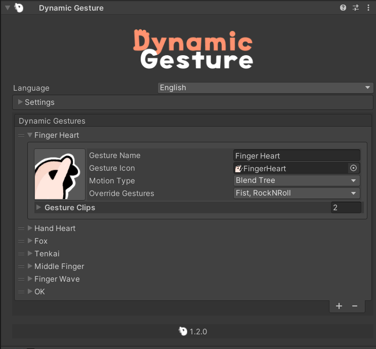

<p align="center">
  
</p>

# {style="width: 32px; height: 32px; vertical-align: -4px; display: inline;"} Dynamic Gesture Guide


## Installation

::: warning
Before installing, please make sure you have [Modular Avatar](https://modular-avatar.nadena.dev/) imported into your Unity project.

[➜ Download Modular Avatar](vcc://vpm/addRepo?url=https://vpm.nadena.dev/vpm.json)
:::

Next, download the **Dynamic Gesture** unitypackage from {style="width: 18px; height: 18px; vertical-align: -3px; display: inline;"} [BOOTH](https://triturbo.booth.pm/items/5408028).

1. Import the downloaded unitypackage into your Unity project.
2. Locate the prefab at:
  ```
  Assets/Triturbo/DynamicGesture/Prefabs/Dynamic Gesture
  ```
  
  
3. Drag and drop the prefab into your Avatar hierarchy.
::: info
The prefab already includes a **Dynamic Gesture component** with a set of default [Dynamic Gesture Assets](dynamic-gesture-asset).
If you prefer, you can also manually add a **Dynamic Gesture component** to a GameObject under your avatar and assign your own assets.

{style="width: 80%"}
:::
## Adding a Gesture Asset

* **Assign an existing asset:** Drag the asset into the list field of the Dynamic Gesture component.
* **Create a new asset:** Press the **`+`** button in the inspector to generate a new [Dynamic Gesture Asset](dynamic-gesture-asset).

## FX Animation

Dynamic Gesture supports **FX Animations**, which allow gestures to trigger facial expressions or other animated effects.

1. Enable FX Animations by checking **`Enable FX Animation`** in the **Settings/Animation Settings**.
  {style="width: 80%"}
2. Assign an animation clip to each gesture slot.
  {style="width: 80%"}
  - The animation will play automatically whenever that gesture is performed.

### FX Path Mode

You can choose how the animation paths are resolved:

- **Absolute:**
  Animation root is relative to the **avatar’s animator root**.

- **Relative:**
  Animation root is relative to the **Dynamic Gesture component** itself.
  Paths will be processed accordingly.

## Settings Overview

- **Enable FX Animation**\
  Turns FX Animation support on or off.

- **FX Enable Mode**\
  Determines how gestures trigger FX Animations:
  - **Either Hand** – Plays the animation when *either* hand performs the gesture.
  - **Both Hands** – Plays the animation *only* when both hands perform the gesture simultaneously.

<!--@include: @contact-us.md-->