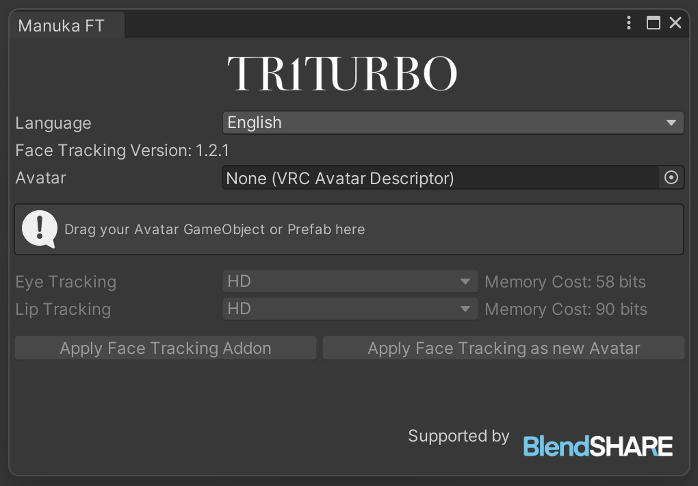
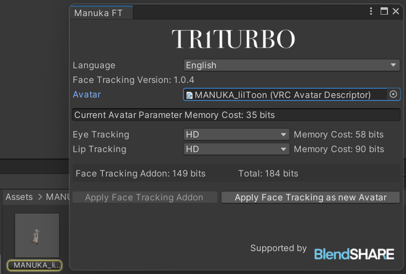

#  Face Tracking Addon Installation Guide

## Quick Checklist

  

    <h3>1) Download</h3>
    
Get both ZIP files from BOOTH.

  

  

    <h3>2) Install dependent packages</h3>
    
Avatar, Modular Avatar, BlendShare, Framework.

  

  

    <h3>3) Import addon</h3>
    
Import avatar-specific face tracking package.

  

  

    <h3>4) Install to avatar</h3>
    
Install face tracking addon to avatar.

  

## Step 1: Required Downloads (BOOTH)

Download from the [Booth store](https://triturbo.booth.pm/).

- `FaceTracking_v1_x_x_for_avatar.zip`\
Contains the Face Tracking Addon `.unitypackage`.
- `TriturboFaceTrackingFramework-v1_x_x.zip`\
Contains the **Triturbo Face Tracking Framework** `.unitypackage` and **BlendShare** `.unitypackage`.

:::info
Both ZIP files are required.
:::

## Step 2: Install Required Packages
1. Original Avatar
2. [ Modular Avatar](https://modular-avatar.nadena.dev/) (`>= 1.9.0`)
3. **BlendShare**
4. **Triturbo Face Tracking Framework**

:::info Package Install Options
**BlendShare**
- Open (or unzip) `TriturboFaceTrackingFramework-v1_x_x.zip` and import the BlendShare `.unitypackage`.
- Or install via VCC/ALCOM. See [BlendShare import instructions](/blendshare/blendshapes-assets#import).

**Face Tracking Framework**
- Open (or unzip) `TriturboFaceTrackingFramework-v1_x_x.zip` and import the **Triturbo Face Tracking Framework** `.unitypackage`.
:::

## Step 3: Import the Face Tracking Addon

1. Open (or unzip) `FaceTracking_v1_x_x_for_avatar.zip`, then find the addon `.unitypackage` file inside.
2. Import that `.unitypackage` into your Unity project.
3. A new menu, `TriturboFT`, appears after import.

4. Click the button in the menu to open the window.

5. Drag your Avatar *GameObject* or *Prefab* into the `Avatar` field.

6. Click `Apply Face Tracking Addon`.

:::tip
If you do not want to modify the original avatar *GameObject*, use `Apply Face Tracking as New Avatar` instead.
:::

An avatar with the **face tracking addon** will appear in *Hierarchy*.

## Preset Options

During installation, you will see preset choices such as:
- HD
- HD (VIVE)
- HD (Quest, Pico)
- SD

Available options may change by version, but naming remains consistent.

- `HD` vs `SD`: Resolution profile (`HD` is higher fidelity but uses more synced parameters).
- Device label in parentheses: Optimized for that device class.
- No device label: General profile using more parameters for broad compatibility.

:::tip
If you use multiple devices, select the general (non-device-specific) version.
:::

::: details Parameter Resolution
Face tracking uses many Expression Parameters for network sync, and VRChat limits this to 256 bits.

- `Bool` uses `1` bit
- `Int` and `Float` use `8` bits

The framework uses parameter quantization to reduce the bit cost needed for float-like behavior.
:::

### VIVE vs Quest/Pico Differences

VIVE (SRanipal parameters), compared with Quest/Pico:
- Eye tracking: No eyebrow detection, but includes pupil diameter detection.
- Mouth tracking: No `MouthDimple`, `MouthStretch`, or `NoseSneer`.

::: info
This description specifically applies to **VIVE Pro Eye**.

These devices do **not** support pupil diameter and also do **not** support `EyeWide` and `EyeSquint`:
- **VIVE Focus 3 + Facial Expression Detection Kit**
- **VIVE Focus Vision**
- **VIVE XR Elite + Full-Face Detection Kit**

For mouth capture quality, VIVE devices are generally similar.
:::

## Need an FBX File?

If you need an FBX file for further modifications, see:

[I need an FBX file with face tracking blendshapes, where can I get it?](./blendshare)

<!--@include: @contact-us.md-->
