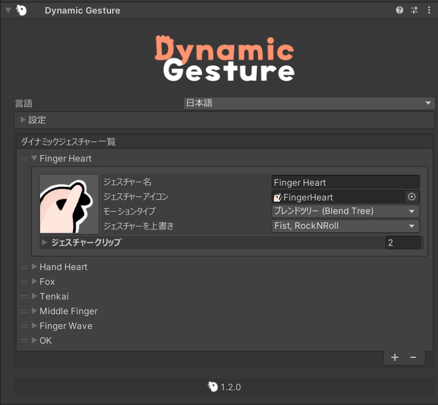

<p align="center">
  
</p>

# {style="width: 32px; height: 32px; vertical-align: -4px; display: inline;"} ダイナミックジェスチャーガイド

## インストール

::: warning
インストール前に、Unityプロジェクトに[Modular Avatar](https://modular-avatar.nadena.dev/)がインポートされていることを確認してください。

[➜ Modular Avatarをダウンロード](vcc://vpm/addRepo?url=https://vpm.nadena.dev/vpm.json)
:::

次に、**Dynamic Gesture** unitypackageを{style="width: 18px; height: 18px; vertical-align: -3px; display: inline;"} [BOOTH](https://triturbo.booth.pm/items/5408028)からダウンロードします。

1. ダウンロードしたunitypackageをUnityプロジェクトにインポートします。
2. 以下の場所にあるプレハブを見つけます：
    ```
    Assets/Triturbo/DynamicGesture/Prefabs/Dynamic Gesture
    ```
    

3. プレハブをアバターヒエラルキーにドラッグ＆ドロップします。
    ::: info
    プレハブには、デフォルトの [Dynamic Gesture Assets](dynamic-gesture-asset) が付属した **Dynamic Gestureコンポーネント** がすでに含まれています。
    必要に応じて、アバター下の GameObject に **Dynamic Gestureコンポーネント** を手動で追加し、独自のアセットを割り当てることもできます。

    {style="width: 80%"}
    :::

## ジェスチャーアセットの追加

* **既存のアセットを割り当てる：** アセットを Dynamic Gesture コンポーネントのリストフィールドにドラッグします。
* **新しいアセットを作成する：** インスペクターの **`+`** ボタンを押して、新しい [Dynamic Gesture Asset](dynamic-gesture-asset) を生成します。

## FXアニメーション

Dynamic Gestureは、ジェスチャーによって表情やその他のアニメーション効果をトリガーできる**FXアニメーション**をサポートしています。

1. **設定/アニメーション設定** で **`FXアニメーションを有効にする`** にチェックを入れてFXアニメーションを有効にします。
  {style="width: 80%"}
2. 各ジェスチャースロットにアニメーションクリップを割り当てます。
  {style="width: 80%"}
  - そのジェスチャーが実行されると、アニメーションが自動的に再生されます。

### FXパスモード

アニメーションパスの解決方法を選択できます：

- **絶対パス：**
  アニメーションのルートは**アバターのアニメータールート**を基準にします。

- **相対パス：**
  アニメーションのルートは**Dynamic Gestureコンポーネント**自体を基準にします。
  パスはそれに応じて処理されます。

## 設定の概要

- **FXアニメーションを有効にする**\
  FXアニメーションのサポートをオンまたはオフにします。

- **FX有効モード**\
  ジェスチャーがFXアニメーションをトリガーする方法を決定します：
  - **どちらかの手** – *いずれかの手* でジェスチャーが実行されたときにアニメーションを再生します。
  - **両手** – *両手* で同時にジェスチャーが実行されたときのみアニメーションを再生します。

<!--@include: ../contact-us.md-->