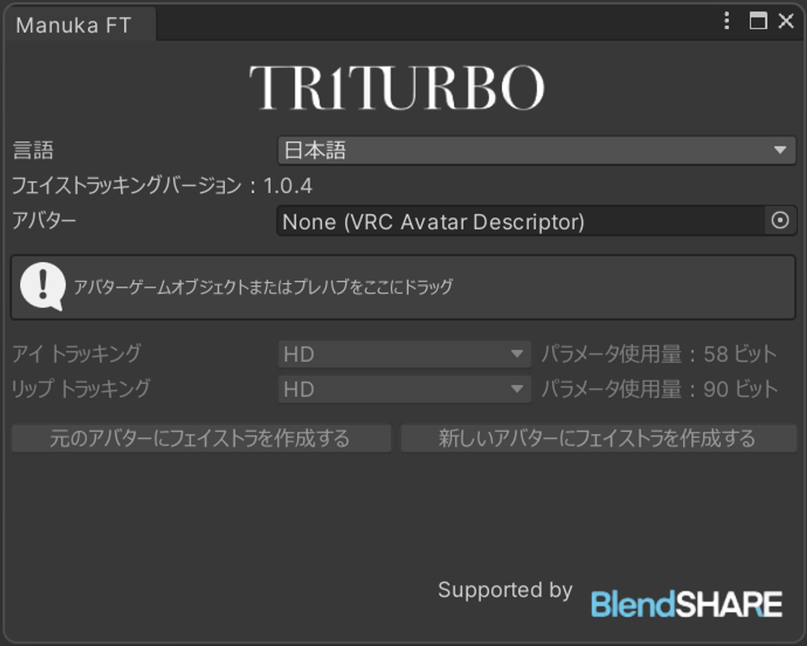
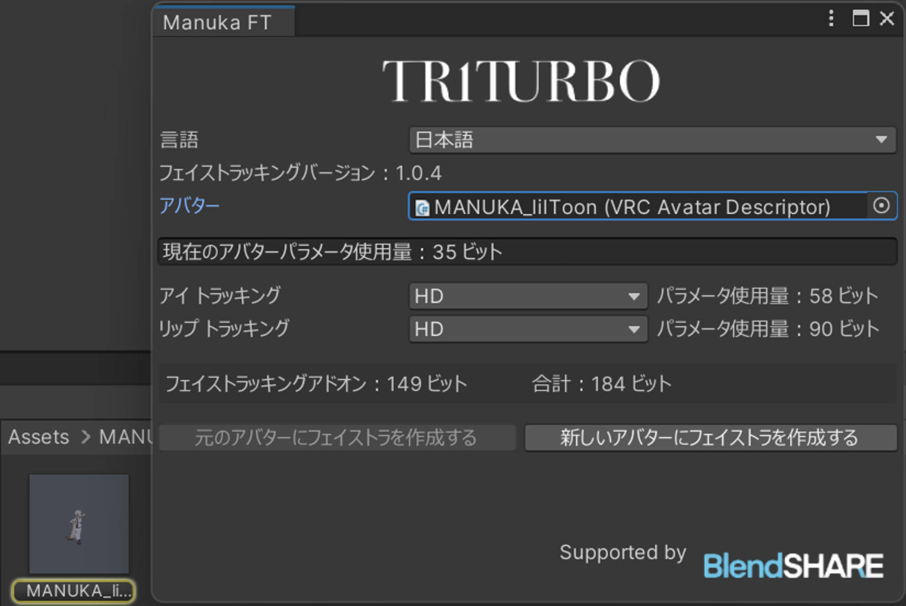

#  顔追跡アドオンのインストールガイド

## クイックチェックリスト

  

    <h3>1) ダウンロード</h3>
    
BOOTH から 2 つの ZIP を入手します。

  

  

    <h3>2) 依存パッケージ導入</h3>
    
Avatar、Modular Avatar、BlendShare、Framework を導入。

  

  

    <h3>3) アドオンを導入</h3>
    
アバター対応の face tracking パッケージをインポート。

  

  

    <h3>4) アバターへ適用</h3>
    
face tracking addon をアバターへ適用します。

  

## Step 1: 必要ファイルのダウンロード（BOOTH）

[Booth ストア](https://triturbo.booth.pm/) からダウンロードしてください。

- `FaceTracking_v1_x_x_for_avatar.zip`\
Face Tracking Addon の `.unitypackage` が含まれます。
- `TriturboFaceTrackingFramework-v1_x_x.zip`\
**Triturbo Face Tracking Framework** の `.unitypackage` と **BlendShare** の `.unitypackage` が含まれます。

:::info
2 つの ZIP はどちらも必須です。
:::

## Step 2: 必要パッケージの導入

1. オリジナル Avatar
2. [ Modular Avatar](https://modular-avatar.nadena.dev/) (`>= 1.9.0`)
3. **BlendShare**
4. **Triturbo Face Tracking Framework**

:::info パッケージ導入オプション
**BlendShare**
- `TriturboFaceTrackingFramework-v1_x_x.zip` を開く（または解凍する）と、BlendShare の `.unitypackage` をインポートできます。
- または VCC/ALCOM から導入できます。詳細は [BlendShare import instructions](/ja/blendshare/blendshapes-assets#import) を参照してください。

**Face Tracking Framework**
- `TriturboFaceTrackingFramework-v1_x_x.zip` を開く（または解凍する）と、**Triturbo Face Tracking Framework** の `.unitypackage` をインポートできます。
:::

## Step 3: Face Tracking Addon のインポート

1. `FaceTracking_v1_x_x_for_avatar.zip` を開く（または解凍する）と、中に addon の `.unitypackage` があります。
2. その `.unitypackage` を Unity プロジェクトへインポートします。
3. インポート後に新しいメニュー `TriturboFT` が表示されます。

4. メニューのボタンをクリックしてウィンドウを開きます。

5. Avatar の *GameObject* または *Prefab* を `Avatar` フィールドへドラッグします。

6. `Apply Face Tracking Addon` をクリックします。

:::tip
オリジナルの Avatar *GameObject* を変更したくない場合は、代わりに `Apply Face Tracking as New Avatar` を使ってください。
:::

**face tracking addon** が適用された Avatar が *Hierarchy* に生成されます。

## プリセットオプション

インストール中に、次のようなプリセットが表示されます:
- HD
- HD (VIVE)
- HD (Quest, Pico)
- SD

利用可能な項目はバージョンによって変わることがありますが、命名規則は共通です。

- `HD` と `SD`: 解像度プロファイル（`HD` は高精度ですが、同期パラメータをより多く使用します）。
- 括弧内のデバイス名: そのデバイス向けに最適化されたプロファイル。
- デバイス名なし: 複数デバイス互換を重視した汎用プロファイル。

:::tip
複数デバイスを使う場合は、汎用版（デバイス名なし）を選ぶことをおすすめします。
:::

::: details パラメータ解像度
Face tracking はネットワーク同期に多くの Expression Parameters を使い、VRChat の上限は 256 bits です。

- `Bool` は `1` bit
- `Int` と `Float` は `8` bits

Framework では、float 的な挙動を保ちながらビット消費を抑えるためにパラメータ量子化を使用しています。
:::

### VIVE と Quest/Pico の違い

Quest/Pico と比較した VIVE（SRanipal parameters）の違い:
- Eye tracking: 眉検出はありませんが、瞳孔径の検出があります。
- Mouth tracking: `MouthDimple`、`MouthStretch`、`NoseSneer` はありません。

::: info
この説明は **VIVE Pro Eye** 向けの内容です。

以下のデバイスは瞳孔径をサポートせず、`EyeWide` と `EyeSquint` もサポートしません:
- **VIVE Focus 3 + Facial Expression Detection Kit**
- **VIVE Focus Vision**
- **VIVE XR Elite + Full-Face Detection Kit**

口トラッキングの品質は、VIVE デバイス間でおおむね同等です。
:::

## FBX ファイルが必要ですか？

face tracking 用 blendshapes 入り FBX が必要な場合は、次を参照してください:

[フェイストラッキングのシェイプキーを含むFBXファイルをどこで手に入れることができますか？](./blendshare)

<!--@include: ../contact-us.md-->
