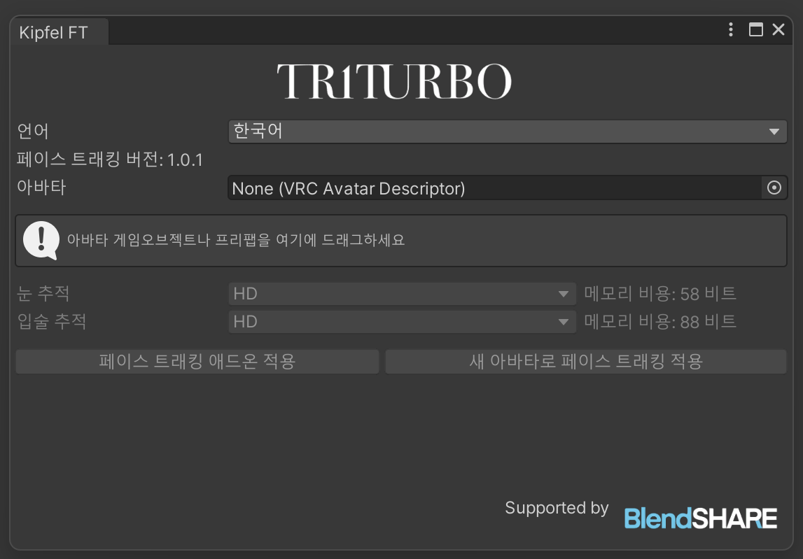
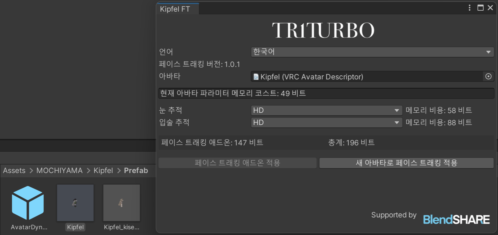

#  페이스 트래킹 애드온 설치 가이드

## 빠른 체크리스트

  

    <h3>1) 다운로드</h3>
    
BOOTH에서 ZIP 2개를 다운로드합니다.

  

  

    <h3>2) 필수 패키지 설치</h3>
    
Avatar, Modular Avatar, BlendShare, Framework를 설치합니다.

  

  

    <h3>3) 애드온 임포트</h3>
    
아바타 전용 face tracking 패키지를 임포트합니다.

  

  

    <h3>4) 아바타에 적용</h3>
    
face tracking addon을 아바타에 적용합니다.

  

## Step 1: 필수 다운로드 (BOOTH)

[Booth 스토어](https://triturbo.booth.pm/)에서 다운로드하세요.

- `FaceTracking_v1_x_x_for_avatar.zip`\
Face Tracking Addon `.unitypackage`가 들어 있습니다.
- `TriturboFaceTrackingFramework-v1_x_x.zip`\
**Triturbo Face Tracking Framework** `.unitypackage`와 **BlendShare** `.unitypackage`가 들어 있습니다.

:::info
두 ZIP 파일 모두 필요합니다.
:::

## Step 2: 필수 패키지 설치

1. 원본 Avatar
2. [ Modular Avatar](https://modular-avatar.nadena.dev/) (`>= 1.9.0`)
3. **BlendShare**
4. **Triturbo Face Tracking Framework**

:::info 패키지 설치 방법
**BlendShare**
- `TriturboFaceTrackingFramework-v1_x_x.zip`를 열기(또는 압축 해제) 후 BlendShare `.unitypackage`를 임포트합니다.
- 또는 VCC/ALCOM으로 설치할 수 있습니다. [BlendShare import instructions](/ko/blendshare/blendshapes-assets#import)을 참고하세요.

**Face Tracking Framework**
- `TriturboFaceTrackingFramework-v1_x_x.zip`를 열기(또는 압축 해제) 후 **Triturbo Face Tracking Framework** `.unitypackage`를 임포트합니다.
:::

## Step 3: Face Tracking Addon 임포트

1. `FaceTracking_v1_x_x_for_avatar.zip`를 열기(또는 압축 해제) 후, 내부의 addon `.unitypackage` 파일을 찾습니다.
2. 해당 `.unitypackage`를 Unity 프로젝트에 임포트합니다.
3. 임포트 후 새 메뉴 `TriturboFT`가 표시됩니다.

4. 메뉴의 버튼을 눌러 창을 엽니다.

5. 아바타 *GameObject* 또는 *Prefab*을 `Avatar` 필드로 드래그합니다.

6. `Apply Face Tracking Addon`을 클릭합니다.

:::tip
원본 아바타 *GameObject*를 수정하고 싶지 않다면 `Apply Face Tracking as New Avatar`를 사용하세요.
:::

**face tracking addon**이 적용된 아바타가 *Hierarchy*에 생성됩니다.

## 프리셋 옵션

설치 중 다음과 같은 프리셋 옵션이 표시됩니다:
- HD
- HD (VIVE)
- HD (Quest, Pico)
- SD

버전에 따라 표시되는 옵션은 달라질 수 있지만, 이름 규칙은 동일합니다.

- `HD` vs `SD`: 해상도 프로필 차이 (`HD`가 더 고품질이지만 동기화 파라미터를 더 많이 사용).
- 괄호의 장치명: 해당 장치군에 최적화된 프로필.
- 장치명 없음: 여러 장치를 위한 범용 프로필.

:::tip
여러 장치를 사용한다면 범용 버전(장치명 없는 버전)을 선택하세요.
:::

::: details 파라미터 해상도
Face tracking은 네트워크 동기화를 위해 많은 Expression Parameters를 사용하며, VRChat 제한은 256 bits입니다.

- `Bool`은 `1` bit
- `Int`와 `Float`는 `8` bits

Framework는 양자화(quantization)로 float 유사 동작의 비트 사용량을 줄입니다.
:::

### VIVE vs Quest/Pico 차이

Quest/Pico 대비 VIVE(SRanipal parameters)의 차이:
- Eye tracking: 눈썹 감지는 없지만 동공 지름 감지는 있습니다.
- Mouth tracking: `MouthDimple`, `MouthStretch`, `NoseSneer`는 지원되지 않습니다.

::: info
위 설명은 **VIVE Pro Eye** 기준입니다.

아래 장치는 동공 지름을 지원하지 않으며 `EyeWide`, `EyeSquint`도 지원하지 않습니다:
- **VIVE Focus 3 + Facial Expression Detection Kit**
- **VIVE Focus Vision**
- **VIVE XR Elite + Full-Face Detection Kit**

입 추적 품질은 VIVE 장치 간에 전반적으로 유사합니다.
:::

## FBX 파일이 필요한가요?

추가 수정용 FBX 파일이 필요하면 아래 문서를 참고하세요:

[페이스 트래킹 블렌드셰이프가 포함된 FBX 파일이 필요합니다. 어디에서 구할 수 있나요?](./blendshare)

<!--@include: ../contact-us.md-->
