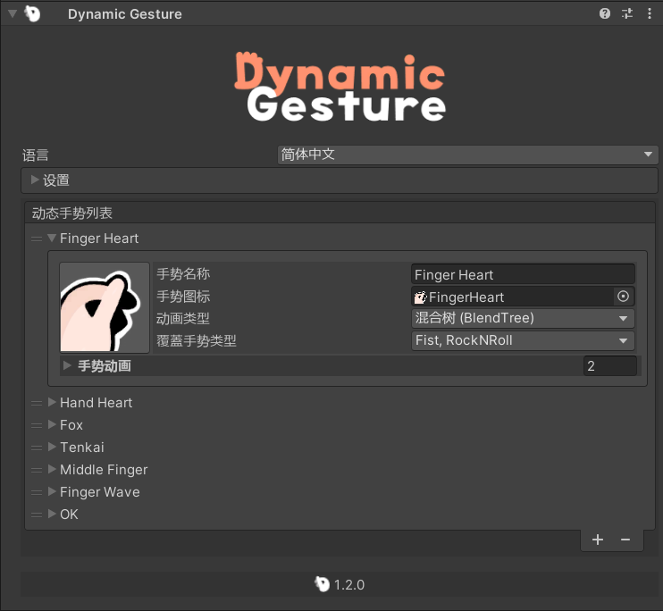

<p align="center">
  
</p>

# {style="width: 32px; height: 32px; vertical-align: -4px; display: inline;"} 动态手势指南

## 安装

::: warning
在安装前，请确保您的 Unity 项目中已导入 [Modular Avatar](https://modular-avatar.nadena.dev/)。

[➜ 下载 Modular Avatar](vcc://vpm/addRepo?url=https://vpm.nadena.dev/vpm.json)
:::

接着，从 {style="width: 18px; height: 18px; vertical-align: -3px; display: inline;"} [BOOTH](https://triturbo.booth.pm/items/5408028) 下载 **Dynamic Gesture** unitypackage。

1. 将下载的 unitypackage 导入到您的 Unity 项目中。
2. 找到预制件：
   ```
   Assets/Triturbo/DynamicGesture/Prefabs/Dynamic Gesture
   ```
   
3. 将预制件拖放到您的 Avatar 层级中。
  ::: info
   该预制件已包含 **动态手势组件**，并附带一组默认的 [Dynamic Gesture Assets](dynamic-gesture-asset)。
   如果需要，您也可以手动在 Avatar 下的某个 GameObject 上添加 **动态手势组件** 并分配自己的资产。

  {style="width: 80%"}
  :::

## 添加手势资产

* **分配已有资产：** 将资产拖到动态手势组件的 `动态手势列表` 中。
* **创建新资产：** 在 检查器(Inspector) 中点击 **`+`** 按钮，生成新的 [Dynamic Gesture Asset](dynamic-gesture-asset)。

## FX 动画

Dynamic Gesture 支持 **FX 动画**，允许手势触发面部表情或其他动画效果。

1. 在 **Settings/Animation Settings** 中勾选 **`Enable FX Animation`** 启用 FX 动画。
   {style="width: 80%"}
2. 为每个手势槽分配动画片段。
   {style="width: 80%"}

* 当执行该手势时，动画会自动播放。

### FX 路径模式

您可以选择动画路径的解析方式：

* **Absolute（绝对）：**
  动画根节点相对于 **Avatar 的 Animator 根节点**。

* **Relative（相对）：**
  动画根节点相对于 **Dynamic Gesture 组件** 本身。
  路径将相应处理。

## 设置概览

* **Enable FX Animation**
  开启或关闭 FX 动画支持。

* **FX Enable Mode**
  决定手势触发 FX 动画的方式：

  * **Either Hand（任意手）** – 当 *任意一只手* 执行手势时播放动画。
  * **Both Hands（双手）** – 仅在 *双手同时* 执行手势时播放动画。

<!--@include: ../contact-us.md-->