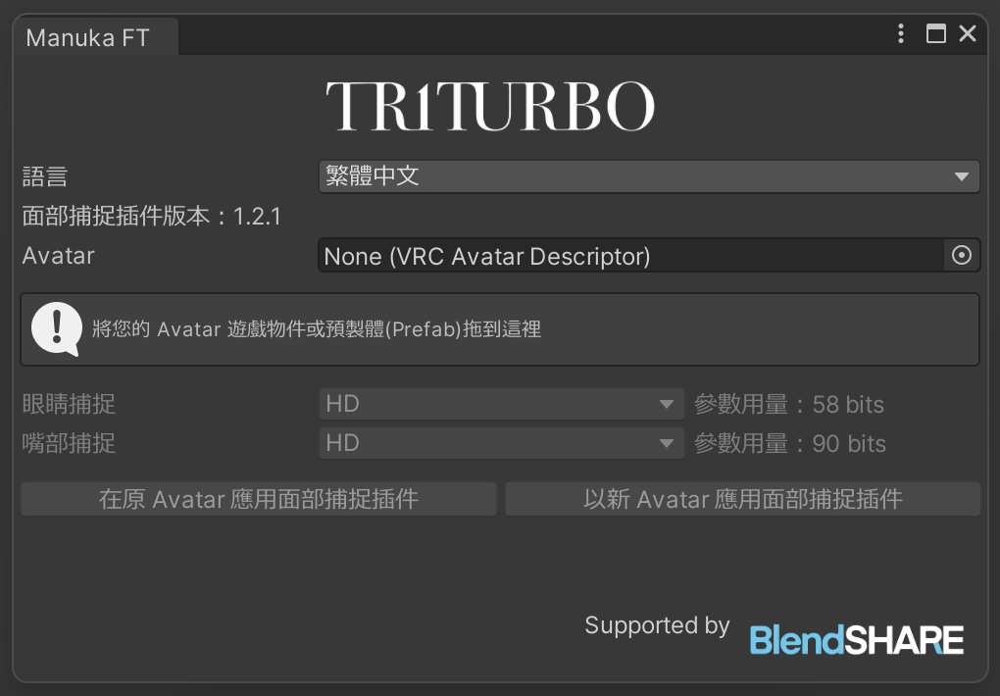

#  面部追踪插件安装指南

## 快速检查清单

  

    <h3>1) 下载</h3>
    
从 BOOTH 下载 2 个 ZIP 文件。

  

  

    <h3>2) 安装依赖包</h3>
    
安装 Avatar、Modular Avatar、BlendShare、Framework。

  

  

    <h3>3) 导入插件</h3>
    
导入对应头像的 face tracking 包。

  

  

    <h3>4) 安装到头像</h3>
    
将 face tracking addon 应用到头像。

  

## Step 1: 必要下载文件（BOOTH）

请从 [Booth 商店](https://triturbo.booth.pm/) 下载。

- `FaceTracking_v1_x_x_for_avatar.zip`\
包含 Face Tracking Addon 的 `.unitypackage`。
- `TriturboFaceTrackingFramework-v1_x_x.zip`\
包含 **Triturbo Face Tracking Framework** 的 `.unitypackage` 和 **BlendShare** 的 `.unitypackage`。

:::info
两个 ZIP 文件都必须下载。
:::

## Step 2: 安装必要包

1. 原始 Avatar
2. [ Modular Avatar](https://modular-avatar.nadena.dev/) (`>= 1.9.0`)
3. **BlendShare**
4. **Triturbo Face Tracking Framework**

:::info 包安装方式
**BlendShare**
- 打开（或解压）`TriturboFaceTrackingFramework-v1_x_x.zip`，导入其中的 BlendShare `.unitypackage`。
- 或使用 VCC/ALCOM 安装。参考 [BlendShare import instructions](/zh-hans/blendshare/blendshapes-assets#import)。

**Face Tracking Framework**
- 打开（或解压）`TriturboFaceTrackingFramework-v1_x_x.zip`，导入其中的 **Triturbo Face Tracking Framework** `.unitypackage`。
:::

## Step 3: 导入 Face Tracking Addon

1. 打开（或解压）`FaceTracking_v1_x_x_for_avatar.zip`，找到其中的 addon `.unitypackage` 文件。
2. 将该 `.unitypackage` 导入到 Unity 项目。
3. 导入后会出现新菜单 `TriturboFT`。

4. 点击菜单按钮打开窗口。

5. 将 Avatar 的 *GameObject* 或 *Prefab* 拖到 `Avatar` 字段。

6. 点击 `Apply Face Tracking Addon`。

:::tip
如果你不想修改原始 Avatar *GameObject*，请使用 `Apply Face Tracking as New Avatar`。
:::

带有 **face tracking addon** 的 Avatar 会出现在 *Hierarchy* 中。

## 预设选项

安装过程中你会看到以下预设：
- HD
- HD (VIVE)
- HD (Quest, Pico)
- SD

可用选项可能因版本而变化，但命名规则保持一致。

- `HD` vs `SD`：分辨率配置（`HD` 精度更高，但会使用更多同步参数）。
- 括号中的设备名：针对该设备类型优化。
- 无设备名：通用配置，兼容范围更广。

:::tip
如果你使用多个设备，建议选择通用版（无设备名）。
:::

::: details 参数分辨率
Face tracking 需要大量 Expression Parameters 进行网络同步，而 VRChat 上限是 256 bits。

- `Bool` 使用 `1` bit
- `Int` 和 `Float` 使用 `8` bits

Framework 使用参数量化来降低类似 float 行为所需的比特成本。
:::

### VIVE 与 Quest/Pico 的差异

与 Quest/Pico 相比，VIVE（SRanipal parameters）有以下差异：
- Eye tracking：不支持眉毛检测，但支持瞳孔直径检测。
- Mouth tracking：不支持 `MouthDimple`、`MouthStretch`、`NoseSneer`。

::: info
以上说明仅针对 **VIVE Pro Eye**。

以下设备不支持瞳孔直径，也不支持 `EyeWide` 与 `EyeSquint`：
- **VIVE Focus 3 + Facial Expression Detection Kit**
- **VIVE Focus Vision**
- **VIVE XR Elite + Full-Face Detection Kit**

在嘴部捕捉质量方面，各 VIVE 设备整体表现接近。
:::

## 需要 FBX 文件？

如果你需要可继续修改的含 face tracking blendshapes 的 FBX，请参考：

[我需要一个带有面部追踪 blendshapes 的 FBX 文件，在哪里可以获取？](./blendshare)

<!--@include: ../contact-us.md-->
