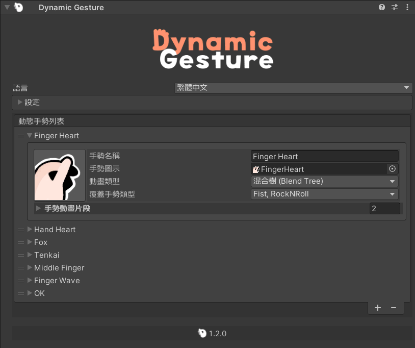

<p align="center">
  
</p>

# {style="width: 32px; height: 32px; vertical-align: -4px; display: inline;"} 動態手勢指南

## 安裝

::: warning
在安裝前，請確認您的 Unity 專案已經導入 [Modular Avatar](https://modular-avatar.nadena.dev/)。

[➜ 下載 Modular Avatar](vcc://vpm/addRepo?url=https://vpm.nadena.dev/vpm.json)
:::


接著，從 {style="width: 18px; height: 18px; vertical-align: -3px; display: inline;"} [BOOTH](https://triturbo.booth.pm/items/5408028) 下載 **Dynamic Gesture** unitypackage。

1. 將下載的 unitypackage 導入到您的 Unity 專案中。
2. 找到預製件：
   ```
   Assets/Triturbo/DynamicGesture/Prefabs/Dynamic Gesture
   ```
   
3. 將預製件拖放到您的 Avatar 層級中。
    ::: info
    該預製件已包含 **Dynamic Gesture 組件**，並附帶一組預設的 [Dynamic Gesture Assets](dynamic-gesture-asset)。
    如果需要，您也可以手動在 Avatar 下的某個 GameObject 上添加 **Dynamic Gesture 組件**，並分配自己的資產。
    {style="width: 80%"}
    :::

## 新增手勢資產

* **指派現有資產：** 將資產拖到 Dynamic Gesture 組件的動態手勢列表欄位中。
* **建立新資產：** 在 檢查器(Inspector) 中點擊 **`+`** 按鈕，生成新的 [Dynamic Gesture Asset](dynamic-gesture-asset)。

## FX 動畫

Dynamic Gesture 支援 **FX 動畫**，允許手勢觸發臉部表情或其他動畫效果。

1. 在 **Settings/Animation Settings** 中勾選 **`Enable FX Animation`** 以啟用 FX 動畫。
   {style="width: 80%"}
2. 為每個手勢槽指派動畫剪輯。
   {style="width: 80%"}

* 當執行該手勢時，動畫會自動播放。

### FX 路徑模式

您可以選擇動畫路徑的解析方式：

* **Absolute（絕對）：**
  動畫根節點相對於 **Avatar 的 Animator 根節點**。

* **Relative（相對）：**
  動畫根節點相對於 **Dynamic Gesture 組件** 本身。
  路徑將會自動處理。

## 設定概覽

* **Enable FX Animation**
  開啟或關閉 FX 動畫支援。

* **FX Enable Mode**
  決定手勢觸發 FX 動畫的方式：

  * **Either Hand（任意手）** – 當 *任意一隻手* 執行手勢時播放動畫。
  * **Both Hands（雙手）** – 僅在 *雙手同時* 執行手勢時播放動畫。

<!--@include:../contact-us.md-->
