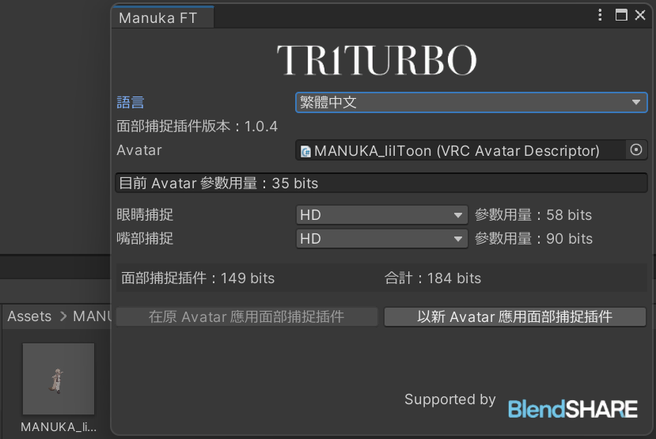

#  面部追蹤套件安裝指南

## 快速檢查清單

  

    <h3>1) 下載</h3>
    
從 BOOTH 下載 2 個 ZIP 檔案。

  

  

    <h3>2) 安裝相依套件</h3>
    
安裝 Avatar、Modular Avatar、BlendShare、Framework。

  

  

    <h3>3) 匯入套件</h3>
    
匯入對應 Avatar 的 face tracking 套件。

  

  

    <h3>4) 套用到 Avatar</h3>
    
將 face tracking addon 套用到 Avatar。

  

## Step 1: 必要下載檔案（BOOTH）

請從 [Booth 商店](https://triturbo.booth.pm/) 下載。

- `FaceTracking_v1_x_x_for_avatar.zip`\
包含 Face Tracking Addon 的 `.unitypackage`。
- `TriturboFaceTrackingFramework-v1_x_x.zip`\
包含 **Triturbo Face Tracking Framework** 的 `.unitypackage` 與 **BlendShare** 的 `.unitypackage`。

:::info
兩個 ZIP 檔都必須下載。
:::

## Step 2: 安裝必要套件

1. 原始 Avatar
2. [ Modular Avatar](https://modular-avatar.nadena.dev/) (`>= 1.9.0`)
3. **BlendShare**
4. **Triturbo Face Tracking Framework**

:::info 套件安裝方式
**BlendShare**
- 開啟（或解壓）`TriturboFaceTrackingFramework-v1_x_x.zip`，匯入其中的 BlendShare `.unitypackage`。
- 或使用 VCC/ALCOM 安裝。請參考 [BlendShare import instructions](/zh-hant/blendshare/blendshapes-assets#import)。

**Face Tracking Framework**
- 開啟（或解壓）`TriturboFaceTrackingFramework-v1_x_x.zip`，匯入其中的 **Triturbo Face Tracking Framework** `.unitypackage`。
:::

## Step 3: 匯入 Face Tracking Addon

1. 開啟（或解壓）`FaceTracking_v1_x_x_for_avatar.zip`，找到其中的 addon `.unitypackage` 檔案。
2. 將該 `.unitypackage` 匯入 Unity 專案。
3. 匯入後會出現新選單 `TriturboFT`。

4. 點選選單按鈕開啟視窗。

5. 將 Avatar 的 *GameObject* 或 *Prefab* 拖到 `Avatar` 欄位。

6. 點擊 `Apply Face Tracking Addon`。

:::tip
如果你不想修改原始 Avatar *GameObject*，請改用 `Apply Face Tracking as New Avatar`。
:::

帶有 **face tracking addon** 的 Avatar 會出現在 *Hierarchy* 中。

## 預設選項

安裝過程中你會看到以下預設：
- HD
- HD (VIVE)
- HD (Quest, Pico)
- SD

可用選項可能會隨版本變動，但命名規則一致。

- `HD` vs `SD`：解析度設定差異（`HD` 精度較高，但會使用更多同步參數）。
- 括號中的裝置名稱：針對該裝置類型最佳化。
- 無裝置名稱：通用版本，兼容範圍較廣。

:::tip
如果你使用多種裝置，建議選擇通用版（無裝置名稱）。
:::

::: details 參數解析度
Face tracking 需要大量 Expression Parameters 進行網路同步，而 VRChat 上限為 256 bits。

- `Bool` 使用 `1` bit
- `Int` 與 `Float` 使用 `8` bits

Framework 使用參數量化技術，降低類 float 行為所需的比特成本。
:::

### VIVE 與 Quest/Pico 的差異

與 Quest/Pico 相比，VIVE（SRanipal parameters）有以下差異：
- Eye tracking：沒有眉毛偵測，但有瞳孔直徑偵測。
- Mouth tracking：不支援 `MouthDimple`、`MouthStretch`、`NoseSneer`。

::: info
以上說明僅適用於 **VIVE Pro Eye**。

以下裝置不支援瞳孔直徑，也不支援 `EyeWide` 與 `EyeSquint`：
- **VIVE Focus 3 + Facial Expression Detection Kit**
- **VIVE Focus Vision**
- **VIVE XR Elite + Full-Face Detection Kit**

嘴部捕捉品質方面，各 VIVE 裝置整體表現大致相同。
:::

## 需要 FBX 檔案嗎？

如果你需要可繼續修改、包含 face tracking blendshapes 的 FBX，請參考：

[我需要一個帶有面部追蹤 blendshapes 的 FBX 檔案，在哪裡可以取得？](./blendshare)

<!--@include: ../contact-us.md-->
